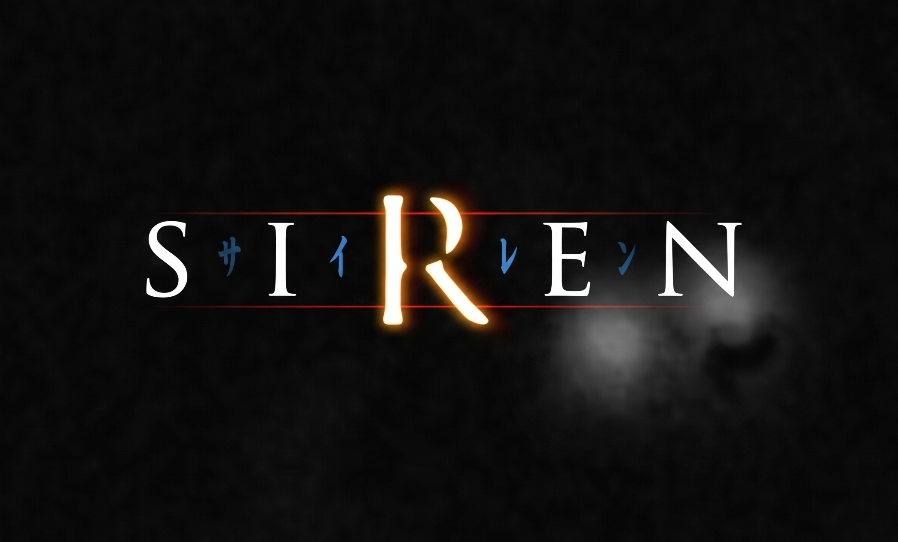

<p align="center"></p>

<p align="center">
  
  
  
  
</p>

Analysis toolkit for the PS2 survival-horror executable `SCUS_973.55` (NTSC-U).
It reads **your own** dump and produces symbol, syscall and stub samples. **No game data is included.**

## Status

| | |
|---|---|
| Entry / code | `0x00100008` / `0x00100000` – `0x002B0E00` |
| BSS end | `0x01F1D380` |
| Compiler | MW MIPS C 2.4.1.01 (stripped) |
| Functions | 3,346 (3,258 unnamed · 66 SDK · 21 thunks) |
| Kernel syscall wrappers | 162 |
| SDK libs | libgraph · libcdvd · libpad · libmpeg · libsd · libsif · libmc |

Details: [`analysis/report.md`](analysis/report.md) · [`docs/MEMORY_MAP.md`](docs/MEMORY_MAP.md)

## Quick start

```bash
# 1. put your own dump in private/  (see private/README.md)
python tools/shibito.py verify      # check ELF hash
python tools/shibito.py report      # regenerate analysis/, symbols/, stubs/
```

Python 3.10+, standard library only. `gcc` is optional (stub syntax check).

## Tools

| Command | Output |
|---|---|
| `verify` | SHA-256 check against `config/game.json` |
| `info` | ELF header, segments, compiler, SDK libs |
| `syscalls` | Kernel syscall wrappers found directly in the ELF |
| `report` | Public-safe samples → `analysis/` `symbols/` `stubs/` |
| `report --full` | Complete dumps → `dev/` (git-ignored) |
| `check-public DIR` | Fails if `DIR` contains game data |

## Samples

| File | Content |
|---|---|
| [`symbols/symbols_sample.csv`](symbols/symbols_sample.csv) | ~210 symbols: address, kind, span, callers |
| [`symbols/symbols_sample.txt`](symbols/symbols_sample.txt) | Same, as `name = address;` |
| [`stubs/stubs_sample.c`](stubs/stubs_sample.c) | 60 signature-only stubs (compile-checked) |
| [`analysis/syscalls.csv`](analysis/syscalls.csv) | All syscall wrappers with EE kernel names |

## Layout

```
assets/    banner
config/    game.json, syscalls.json
tools/     shibito.py  elfkit.py  ghidrakit.py  analyze.py  release.py
analysis/  generated reports
symbols/   symbol samples
stubs/     stub samples + types.h
private/   your dump (git-ignored)
```

## Legal

Unofficial fan project; not affiliated with or endorsed by any rights holder. Trademarks belong to their owners.
This repo contains no ROM, ISO, ELF, assets or decompiled game code. Bring your own legally obtained copy.
Tools are [MIT](LICENSE). Contributions must be original code — never paste decompiler output or game bytes.
